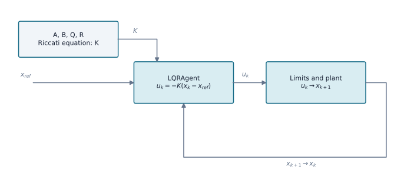

# Linear-Quadratic Regulator (LQR)

`LQRAgent` implements discrete state feedback for a supplied linear model. It solves the algebraic Riccati equation with `scipy.linalg.solve_discrete_are` and returns `u = -K(x-x_ref)`.

## Method structure

{ width=1000 }

The gain `K` is computed offline from the model and weights. During operation, the agent uses the reference `x_ref` and measured state `x_k`; command limits and plant dynamics are external to `LQRAgent`.

```python
import numpy as np
from tensoraerospace.agent.lqr import LQRAgent

A = np.array([[1.0, 0.02], [0.0, 0.98]])
B = np.array([[0.0], [0.1]])
agent = LQRAgent(A, B, Q=np.eye(2), R=np.array([[0.1]]))
u = agent.predict(state=np.array([0.1, 0.0]))
```

The caller supplies consistent state/input units and enforces physical command limits. Integral states may be included in the model for LQI. Stability of the local linear closed loop does not prove stability of a nonlinear plant.

## Nonlinear F-16 example

```bash
python -m example.lqr_controllers.example_lqr_f16 --output outputs/lqr-f16
```

The example linearizes the healthy longitudinal F-16 around trim and runs nominal and wing-damage scenarios. Metrics, traces and vector plots are written to the output directory.

::: tensoraerospace.agent.lqr.LQRAgent
