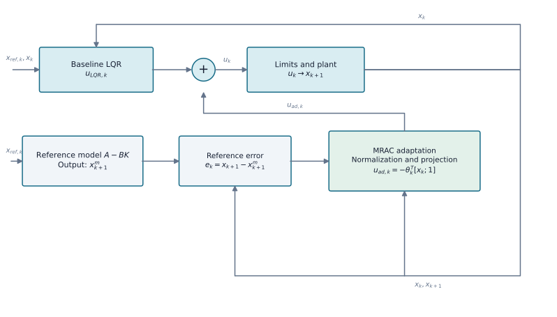

# LQR with Model-Reference Adaptive Control (LQR–MRAC)

`LQRMRACAgent` adds a bounded adaptive command to an existing `LQRAgent`. The reference model is the nominal closed loop `A-BK`; consequently, an exact healthy model produces zero reference error and no parameter update.

## Method structure

{ width=1200 }

The LQR command and adaptive augmentation are summed before the plant. The error between the measured and reference states updates the parameters `θ`, which produce compensation at the next step. Normalization, a deadzone, projection and the adaptive-command bound are applied in the update law.

```python
from tensoraerospace.agent.lqr import LQRMRACAgent, LQRMRACConfig

agent = LQRMRACAgent(
    baseline_lqr,
    LQRMRACConfig(
        dt=0.02,
        adaptation_gain=0.002,
        deadzone=1e-4,
        parameter_limit=20.0,
        adaptive_limit=1.0,
    ),
)
agent.reset(initial_state)
command = agent.predict(state, reference_state)
agent.update(state, next_state, reference_state)
```

The implementation requires full state feedback and addresses matched uncertainty. Updates include regressor normalization, a deadzone and parameter projection. The adaptive command is bounded separately from the baseline command. Set `adaptation_enabled=False` for a frozen ablation; measurement feedback remains active.

These safeguards do not prove stability of a nonlinear closed-loop system. Parameter bounds and gains must be scaled to the model units and evaluated under noise, saturation and actuator limits. Structural wing loss changes aerodynamics and inertia and is not a matched actuator fault. For the predictor-based variant, see [LQR–PMRAC](lqr_pmrac.md).

## Nonlinear F-16 example

```bash
python -m example.lqr_controllers.example_lqr_mrac_f16 --output outputs/lqr-mrac-f16
```

The example compares LQR, online MRAC and MRAC frozen at the damage event on the same nonlinear plant. No fault time or damage magnitude is passed to the online adaptation law.

::: tensoraerospace.agent.lqr.mrac.LQRMRACAgent
::: tensoraerospace.agent.lqr.mrac.LQRMRACConfig
