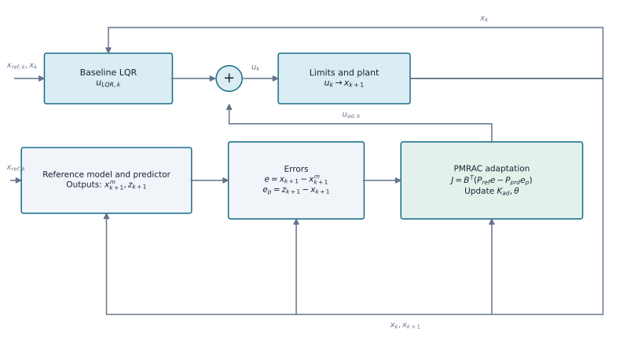

# LQR with Predictor-Based MRAC (LQR–PMRAC)

`LQRPMRACAgent` implements a simplified predictor-based augmentation inspired by Lavretsky, Gadient and Gregory. In addition to the reference-model error, its adaptive laws use the error between a state predictor and the measured plant. Unlike the full predictor in the paper, this implementation does not feed the current adaptive parameter estimates back into the predictor.

## Method structure

{ width=1200 }

The predictor produces the state `z`, while the training signal `J` combines the reference error `e` and prediction error `e_p`. These errors update the state gains `K_ad` and RBF parameters `θ`; the adaptive command is added to the baseline LQR command.

```python
from tensoraerospace.agent.lqr import LQRPMRACAgent, LQRPMRACConfig

agent = LQRPMRACAgent(
    baseline_lqr,
    LQRPMRACConfig(dt=0.02, adaptation_gain=0.002, predictor_ratio=3.0),
)
agent.reset(initial_state)
command = agent.predict(state, reference_state)
agent.update(state, next_state, reference_state)
```

The reference model is the nominal LQR closed loop. The predictor transition is discretized exactly; adaptive updates include normalization, a deadzone, per-control-channel parameter projection and a bounded adaptive command. RBFs act on the first state coordinate, angle of attack in the F-16 example. Construction requires a nonsingular `A-BK` without negative real eigenvalues and with a finite real matrix logarithm; this restriction is not present in conventional MRAC.

The method requires full state feedback and addresses matched uncertainty, such as reduced actuator effectiveness. Structural wing damage also changes aerodynamics and inertia and must not be presented as a matched actuator fault. Numerical safeguards do not prove stability of a nonlinear closed-loop system.

## Nonlinear F-16 example

```bash
python -m example.lqr_controllers.example_lqr_pmrac_f16 --output outputs/lqr-pmrac-f16
```

The example compares LQR, conventional MRAC and PMRAC in online and frozen forms. The fault scenario reduces stabilator effectiveness without changing the aerodynamic tables.

Reference: [Lavretsky, Gadient, Gregory, Predictor-Based Model Reference Adaptive Control](https://ntrs.nasa.gov/api/citations/20090032037/downloads/20090032037.pdf).

::: tensoraerospace.agent.lqr.pmrac.LQRPMRACAgent
::: tensoraerospace.agent.lqr.pmrac.LQRPMRACConfig
