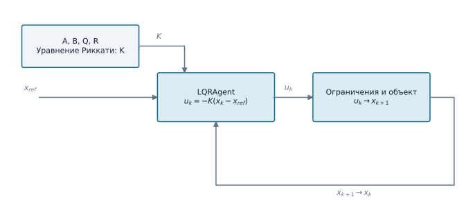

# Линейно-квадратичный регулятор (LQR)

`LQRAgent` реализует дискретную обратную связь по состоянию для заданной линейной модели. Матрица коэффициентов вычисляется через уравнение Риккати (`scipy.linalg.solve_discrete_are`), команда имеет вид `u = -K(x-x_ref)`.

## Структура метода

{ width=1000 }

Матрица `K` рассчитывается заранее по модели и весам. Во время работы агент использует задание `x_ref` и измеренное состояние `x_k`; ограничения команды и динамика объекта находятся вне `LQRAgent`.

```python
import numpy as np
from tensoraerospace.agent.lqr import LQRAgent

A = np.array([[1.0, 0.02], [0.0, 0.98]])
B = np.array([[0.0], [0.1]])
agent = LQRAgent(A, B, Q=np.eye(2), R=np.array([[0.1]]))
u = agent.predict(state=np.array([0.1, 0.0]))
```

Пользователь задаёт согласованные единицы состояния и входа, а также ограничивает физическую команду. Для LQI в модель можно включить интегральные состояния. Устойчивость локальной линейной системы не доказывает устойчивость нелинейного объекта.

## Пример на нелинейном F-16

```bash
python -m example.lqr_controllers.example_lqr_f16 --output outputs/lqr-f16
```

Пример линеаризует продольную модель исправного F-16 около балансировки и выполняет номинальный сценарий и сценарий повреждения крыла. Метрики, траектории и векторные графики сохраняются в выходной каталог.

::: tensoraerospace.agent.lqr.LQRAgent
