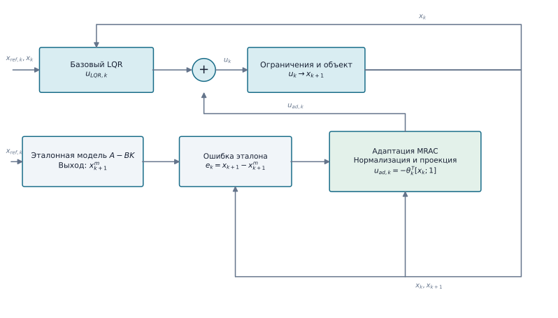

# LQR с модельно-эталонным адаптивным управлением (LQR–MRAC)

`LQRMRACAgent` добавляет ограниченную адаптивную команду к существующему `LQRAgent`. Эталонная модель совпадает с номинальной замкнутой системой `A-BK`. На точной исправной модели ошибка эталона и обновление параметров равны нулю только после синхронизации через `reset(initial_state)` и при отсутствии насыщения базовой команды. Внешние ограничения амплитуды и скорости команды не входят в эталонную модель, поэтому при насыщении ошибка становится ненулевой.

## Структура метода

{ width=1200 }

Команда LQR и адаптивная добавка суммируются перед объектом. Ошибка между измеренным и эталонным состояниями обновляет параметры `θ`, которые формируют компенсацию на следующем шаге. Нормализация, мёртвая зона, проекция и ограничение адаптивной команды выполняются в законе обновления.

```python
from tensoraerospace.agent.lqr import LQRMRACAgent, LQRMRACConfig

agent = LQRMRACAgent(
    baseline_lqr,
    LQRMRACConfig(
        dt=0.02,
        adaptation_gain=0.002,
        deadzone=1e-4,
        parameter_limit=20.0,
        adaptive_limit=1.0,
    ),
)
agent.reset(initial_state)
command = agent.predict(state, reference_state)
agent.update(state, next_state, reference_state)
```

Требуются измерения полного состояния; рассматривается согласованная неопределённость. Обновление включает нормализацию регрессора, мёртвую зону и проекцию параметров. Адаптивная команда ограничивается отдельно от команды LQR. Для frozen-контроля используется `adaptation_enabled=False`, измерительная обратная связь при этом сохраняется.

Эти ограничения не доказывают устойчивость нелинейной замкнутой системы. Пределы и коэффициенты должны соответствовать единицам модели и проверяться при шумах, насыщении и ограничениях привода. Потеря крыла меняет аэродинамику и инерцию и не относится к matched-отказу привода. Предсказательный вариант описан на странице [LQR–PMRAC](lqr_pmrac.md).

## Пример на нелинейном F-16

```bash
python -m example.lqr_controllers.example_lqr_mrac_f16 --output outputs/lqr-mrac-f16
```

Пример сравнивает LQR, online-MRAC и MRAC с заморозкой в момент повреждения на одном нелинейном объекте. Закон online-адаптации не получает ни момент, ни величину повреждения.

::: tensoraerospace.agent.lqr.mrac.LQRMRACAgent
::: tensoraerospace.agent.lqr.mrac.LQRMRACConfig
