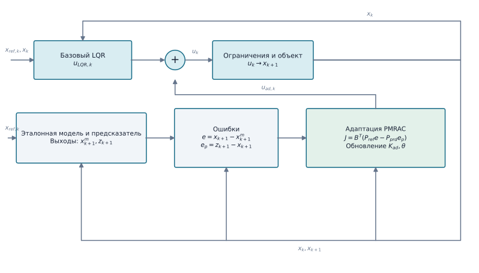

# LQR с предсказательным MRAC (LQR–PMRAC)

`LQRPMRACAgent` реализует упрощённую предсказательную адаптивную надстройку по мотивам работы Lavretsky, Gadient и Gregory. Наряду с ошибкой эталонной модели закон адаптации использует ошибку между предсказателем состояния и измеренным объектом. В отличие от полного предсказателя в статье, текущие оценки адаптивных параметров в этой реализации не подаются обратно в предсказатель.

## Структура метода

{ width=1200 }

Предсказатель формирует состояние `z`, а обучающий сигнал `J` объединяет ошибку эталона `e` и ошибку предсказания `e_p`. На их основе обновляются коэффициенты состояния `K_ad` и параметры RBF `θ`; адаптивная команда добавляется к базовому LQR.

```python
from tensoraerospace.agent.lqr import LQRPMRACAgent, LQRPMRACConfig

agent = LQRPMRACAgent(
    baseline_lqr,
    LQRPMRACConfig(dt=0.02, adaptation_gain=0.002, predictor_ratio=3.0),
)
agent.reset(initial_state)
command = agent.predict(state, reference_state)
agent.update(state, next_state, reference_state)
```

Эталонная модель совпадает с номинальной системой под LQR. Переход предсказателя дискретизуется точно; обновления включают нормализацию, мёртвую зону, проекцию параметров для каждого канала управления и ограничение адаптивной команды. RBF-функции действуют по первой координате состояния, в примере F-16 — по углу атаки. Для создания агента матрица `A-BK` должна быть невырожденной, не иметь отрицательных вещественных собственных чисел и иметь конечный вещественный матричный логарифм; в обычном MRAC этого ограничения нет.

Требуются измерения полного состояния; рассматривается согласованная неопределённость, например снижение эффективности привода. Потеря крыла меняет также аэродинамику и инерцию, поэтому её нельзя выдавать за matched-отказ привода. Численные ограничения не доказывают устойчивость нелинейной замкнутой системы.

## Пример на нелинейном F-16

```bash
python -m example.lqr_controllers.example_lqr_pmrac_f16 --output outputs/lqr-pmrac-f16
```

Пример сравнивает LQR, обычный MRAC и PMRAC в online- и frozen-вариантах. В fault-сценарии уменьшается эффективность стабилизатора без изменения аэродинамических таблиц.

Источник: [Lavretsky, Gadient, Gregory, Predictor-Based Model Reference Adaptive Control](https://ntrs.nasa.gov/api/citations/20090032037/downloads/20090032037.pdf).

::: tensoraerospace.agent.lqr.pmrac.LQRPMRACAgent
::: tensoraerospace.agent.lqr.pmrac.LQRPMRACConfig
